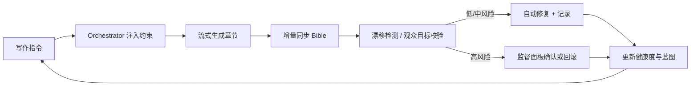
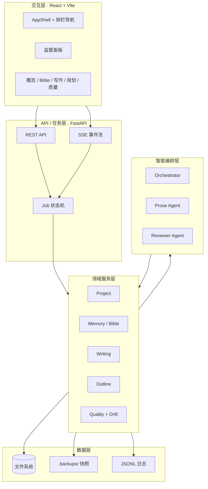

# xsagent

面向长篇小说创作的 AI 智能体系统（Web + API）。以 **Story Bible（结构化记忆）** 为中心，提供「监督式全自动」写作辅助：系统默认自主完成写作、记忆同步、漂移检测与轻量修复，作者只在高风险节点做最终决策。


- **不烂尾**：正文是唯一事实源，写入后自动增量同步设定集，上下文不膨胀
- **不吃书**：漂移检测 + 风险分级，低/中风险自动修复，高风险推送监督面板
- **可回滚**：每次自动改动前写快照，任意动作可一键回滚
- **可离线**：内置 `simulator` 模式，无需任何 API Key 即可完整体验全流程

---

## 目录

- [核心特性](#核心特性)
- [系统架构](#系统架构)
- [技术栈](#技术栈)
- [快速开始](#快速开始)
- [推荐创作流程](#推荐创作流程)
- [LLM 配置](#llm-配置)
- [配置参考](#配置参考)
- [项目结构](#项目结构)
- [Web 页面](#web-页面)
- [API 参考](#api-参考)
- [异步任务与 SSE](#异步任务与-sse)
- [测试](#测试)
- [开发阶段](#开发阶段)
- [常见问题](#常见问题)
- [相关文档](#相关文档)
- [许可证](#许可证)

---

## 核心特性

| 模块 | 能力 |
|------|------|
| 项目管理 | 创建 / 列表 / 概览 / 更新 / 删除，干预级别（`aggressive` / `balanced` / `conservative`），健康度 0–100 |
| 创作引导 | AI 深度问答 3–6 轮 → 生成 Story Bible 草案 → Diff 预览 → 一键应用 |
| Story Bible | 角色 / 情节 / 世界观 / 备注 / 时间线五大分区，字段锁 + JSON Patch + 批量采纳 |
| 三级大纲 | 总纲 → 分卷 → 章级蓝图，支持从 Bible 自动生成与单章预览 |
| 长篇规模规划 | 按目标字数推导分卷与章节规模，数据口径统一 |
| 章节写作 | 异步 Job + SSE 流式输出，自动注入约束与最新蓝图，写后自动同步设定集 |
| 质量闭环 | 目标校验、漂移检测、风险分级、自动修复 / 待办确认 / 回滚，操作日志可审计 |
| 记忆维护 | `dream`（去重、清理失效引用）与 `distill`（从监督决议提炼风格规则） |
| 知识图谱 | 从正文后台抽取实体关系，轻量可视化，仅作辅助不主导写入 |
| 探索采纳 | 一次生成多套章节方案，选中后写回章级蓝图 |
| 监督面板 | 全局右侧栏：健康度、最近 AI 动作、待处理事项（按风险排序）、快捷入口 |

写作闭环：



---

## 系统架构



**分层职责**

- **交互层**：React 工作台，统一由右侧监督面板承载健康度、待办与回滚操作。
- **API / 任务层**：REST + SSE；写作、批量写作以异步 Job 执行，前端订阅事件流实时展示进度。
- **领域服务层**：`project` / `memory` / `writing` / `outline` / `quality` / `explore` / `onboarding` 等纯业务逻辑，与存储解耦。
- **智能编排层**：`Orchestrator` 串起「生成 → 校验 → 同步 → 检测 → 修复 → 压缩」；`Prose` / `Reviewer` / `VolumeOrchestrator` 为子代理。
- **数据层**：文件系统为存储介质；章节 Markdown 是事实源，设定集 JSON 是派生记忆，`.backups/` 提供快照与回滚。

---

## 技术栈

| 层级 | 选型 |
|------|------|
| 后端 | Python 3.11+、FastAPI、Uvicorn、Pydantic v2 |
| LLM | 可插拔 Provider：`simulator` / `ollama` / `deepseek` |
| 任务 | `asyncio` + 内存 Job 队列 + SSE |
| 存储 | 本地文件系统（JSON / Markdown / JSONL） |
| 前端 | React 18、Vite 6、TypeScript 5、React Router v6 |
| 状态 | Zustand（UI 状态）+ TanStack Query（服务端缓存 / SSE） |
| 样式 | 原生 CSS + Design Token（`tokens.css`） |
| 测试 | pytest、pytest-asyncio、httpx、Playwright |

---

## 快速开始

### 环境要求

- Python **3.11+**
- Node.js **18+**（仅 Web 前端需要）
- 无需数据库、Redis 或 GPU；默认 `simulator` 模式开箱即用

### 1. 安装后端依赖

```bash
python -m venv .venv
pip install -e ".[dev]"
```

激活虚拟环境：

```bash
# macOS / Linux
source .venv/bin/activate

# Windows PowerShell
.venv\Scripts\Activate.ps1
```

### 2. 准备配置（可选）

`simulator` 模式无需任何配置即可启动。如需使用真实模型，复制示例配置后填写密钥：

```bash
# macOS / Linux
cp config.example.yaml config.yaml

# Windows
copy config.example.yaml config.yaml
```

> `config.yaml` 已被 `.gitignore` 忽略，**请勿提交 API Key**。也可以完全不建文件，改用环境变量（见 [配置参考](#配置参考)）。

### 3. 启动 API 服务

```bash
# 方式一：读取 config.yaml / 环境变量后启动
python -m xsagent

# 方式二：uvicorn 直接启动（开发模式）
uvicorn xsagent.api.app:create_app --factory --reload --port 8000
```

- 服务地址：`http://localhost:8000`
- 健康检查：`http://localhost:8000/health`
- 交互式 API 文档（Swagger）：`http://localhost:8000/docs`

### 4. 启动 Web 前端

```bash
# 仓库根目录安装依赖（npm workspaces）
npm install

# 启动前端（Vite 已配置 /api、/health 代理到 :8000）
cd packages/web
npm run dev
```

浏览器访问 <http://localhost:5173>。

> 也可以从仓库根目录使用脚本：`npm run dev:api` / `npm run dev:web` / `npm run build:web`（其中 `dev:web` 依赖 pnpm）。

### 5. 创建第一个项目

在 Web 首页点击「新建项目」，或直接用 API：

```bash
curl -X POST http://localhost:8000/api/projects \
  -H "Content-Type: application/json" \
  -d '{"name":"夜半来信","genre":"悬疑","intervention_level":"balanced"}'

# 查看项目健康度
curl http://localhost:8000/api/projects/{project_id}/status
```

---

## 推荐创作流程

1. **选择 LLM**：侧栏底部进入 `/settings/llm`，填入 DeepSeek Key，或保留 `simulator` 试用。
2. **新建项目** → 进入项目概览，按「新手路径」推进。
3. **创作引导**：AI 问答 3–6 轮 → 生成草案 → Diff 预览 → 应用到设定集。
4. **章节规划**：推导长篇规模，生成总纲 / 分卷 / 章级蓝图。
5. **写作**：触发 AI 写作，实时查看流式输出与 Job 进度。
6. **监督处理**：高风险项在监督面板确认 / 忽略 / 回滚；中低风险已自动处理，可按需回滚。
7. **质量复盘**：质量仪表盘查看健康度与关键指标，必要时执行记忆维护或探索多方案。

干预级别对应的自动化程度：

| 级别 | 低风险 | 中风险 | 高风险 |
|------|--------|--------|--------|
| `aggressive` | 自动 | 自动 | 推送，可配置超时自动采纳 |
| `balanced`（默认） | 自动 | 自动（记录 Diff） | **必须确认** |
| `conservative` | 自动 | 需确认 | 需确认 |

---

## LLM 配置

三种运行模式，通过 `XSAGENT_LLM_MODE` 或 Web 设置页切换：

| 模式 | 说明 | 是否需要密钥 |
|------|------|--------------|
| `simulator` | 读取内置 fixtures 的确定性模拟器，适合试用与回归测试 | 否 |
| `ollama` | 本地 Ollama 服务，默认模型 `qwen2.5:14b` | 否 |
| `deepseek` | DeepSeek 官方 API，支持 `reasoning_effort` 与 thinking | 是 |

### 方式一：Web 设置页（推荐）

1. 打开 `http://localhost:5173/settings/llm`
2. 运行模式切换为 `deepseek`
3. 填写 `DeepSeek API Key` 与模型（默认 `deepseek-v4-pro`）
4. 推荐：`reasoning_effort=high`、`thinking=enabled`、开启「隐藏思考内容」

保存后会写入仓库根目录的 `config.yaml`（该文件不会进入 Git）。

### 方式二：环境变量

```bash
# macOS / Linux
export XSAGENT_LLM_MODE=deepseek
export XSAGENT_DEEPSEEK_API_KEY=sk-your-key

# Windows PowerShell
$env:XSAGENT_LLM_MODE = "deepseek"
$env:XSAGENT_DEEPSEEK_API_KEY = "sk-your-key"
```

### 方式三：config.yaml

```yaml
llm:
  mode: "deepseek"
  deepseek_base_url: "https://api.deepseek.com"
  deepseek_api_key: ""
  deepseek_model: "deepseek-v4-pro"
  deepseek_reasoning_effort: "high"
  deepseek_thinking_enabled: true
  strip_think_tags: true
```

> 环境变量优先级高于 `config.yaml`；Web 设置页保存会重写 `config.yaml` 的 `llm` 段。

---

## 配置参考

### 环境变量

| 变量 | 默认值 | 说明 |
|------|--------|------|
| `XSAGENT_CONFIG_PATH` | `./config.yaml` | 自定义配置文件路径 |
| `XSAGENT_DATA_DIR` | `./data/projects` | 项目存储根目录 |
| `XSAGENT_DEBUG` | `false` | 调试模式（`python -m xsagent` 时开启热重载） |
| `XSAGENT_LOG_LEVEL` | `info` | 日志级别 |
| `XSAGENT_SERVER_HOST` | `0.0.0.0` | 监听地址 |
| `XSAGENT_SERVER_PORT` | `8000` | 监听端口 |
| `XSAGENT_LLM_MODE` | `simulator` | `simulator` / `ollama` / `deepseek` |
| `XSAGENT_OLLAMA_BASE_URL` | `http://localhost:11434` | Ollama 服务地址 |
| `XSAGENT_OLLAMA_MODEL` | `qwen2.5:14b` | Ollama 模型 |
| `XSAGENT_OLLAMA_THINK` | `false` | 是否请求 Ollama 思考内容 |
| `XSAGENT_STRIP_THINK_TAGS` | `true` | 是否剥离输出中的 think 标签 |
| `XSAGENT_DEEPSEEK_BASE_URL` | `https://api.deepseek.com` | DeepSeek API 地址 |
| `XSAGENT_DEEPSEEK_API_KEY` | 空 | DeepSeek API Key（优先于配置文件） |
| `XSAGENT_DEEPSEEK_MODEL` | `deepseek-v4-pro` | DeepSeek 模型 |
| `XSAGENT_DEEPSEEK_REASONING_EFFORT` | `high` | 推理强度 |
| `XSAGENT_DEEPSEEK_THINKING_ENABLED` | `true` | 是否开启 thinking |
| `XSAGENT_LLM_LOG_ENABLED` | `true` | 是否记录 LLM 调用日志 |
| `XSAGENT_LLM_LOG_MAX_CHARS` | `32000` | 单条 LLM 日志最大字符数 |

示例文件见 [config.example.yaml](./config.example.yaml)。

### 项目数据目录

每个项目在 `XSAGENT_DATA_DIR` 下独占一个子目录，由 API 从 `templates/default` 初始化：

```
data/projects/{project_id}/
├── xsagent.json            # 项目元信息 + 干预级别 + 引导状态
├── config.yaml             # 项目级运行参数
├── story_bible/
│   ├── characters.json
│   ├── plot.json
│   ├── world.json
│   ├── notes.json
│   └── timeline.json
├── outlines/
│   ├── master.json         # 总纲
│   ├── volumes/            # 分卷
│   └── chapters/           # 章级蓝图
├── chapters/
│   └── ch_001.md           # 正文（最终事实源）
├── knowledge/
│   └── graph.json          # 轻量知识图谱
├── logs/
│   ├── actions.jsonl       # 操作日志（监督面板数据源）
│   └── llm.jsonl           # LLM 调用日志
└── .backups/
    └── {timestamp}/        # 快照，用于回滚
```

> `data/`、`test-results/`、`playwright-report/` 均已加入 `.gitignore`。

---

## 项目结构

```
newxsagent/
├── src/xsagent/                 # Python 后端包
│   ├── api/
│   │   ├── app.py               # FastAPI 应用工厂
│   │   └── routes/              # projects / bible / chapters / outlines / jobs
│   │                            # supervision / onboarding / maintenance
│   │                            # explore / snapshots / settings / health
│   ├── core/                    # 配置、异常、依赖注入
│   ├── domain/
│   │   ├── project/             # 项目与健康度
│   │   ├── memory/              # Bible、Patch 引擎、dream 记忆整理
│   │   ├── writing/             # 章节写作、检查点、上下文压缩
│   │   ├── outline/             # 总纲 / 分卷 / 蓝图与规模推导
│   │   ├── quality/             # 漂移风险、目标校验、待办事项
│   │   ├── narrative/           # 硬约束、关系、线程进度、文本归一化
│   │   ├── onboarding/          # 创作引导会话
│   │   ├── explore/             # 探索方案
│   │   ├── llm_log/             # LLM 调用日志
│   │   └── action_log/          # 操作日志
│   ├── agents/                  # Orchestrator / Prose / Reviewer
│   │   ├── volume_orchestrator.py
│   │   ├── checkpoint_writer.py
│   │   ├── maintenance.py       # dream / distill
│   │   ├── explore.py
│   │   ├── onboarding.py
│   │   ├── outline_planner.py
│   │   └── prompts/             # 各 Agent 提示词与注册表
│   ├── jobs/                    # Job 状态机与事件
│   ├── llm/                     # Provider 抽象、simulator / ollama / deepseek、解析
│   └── storage/                 # 项目文件读写、快照
├── packages/web/                # React 前端（Vite）
│   └── src/
│       ├── app/                 # 路由与项目布局
│       ├── pages/               # 各页面
│       ├── components/          # primitives / layout / features / feedback
│       ├── api/                 # 类型化 API 客户端
│       ├── constants/           # 前端提示词常量
│       ├── lib/                 # 规模规划等工具
│       └── styles/              # tokens.css / global.css / animations.css
├── templates/default/           # 项目初始化模板
├── tests/
│   ├── unit/                    # 领域单测
│   ├── api/                     # 端点与集成测试
│   ├── golden/                  # LLM 结构化输出回归
│   └── e2e/                     # Playwright
├── config.example.yaml
├── pyproject.toml
└── package.json                 # npm workspaces 根
```

---

## Web 页面

| 路由 | 页面 | 说明 |
|------|------|------|
| `/` | 项目列表 | 新建 / 进入项目 |
| `/settings/llm` | LLM 设置 | 运行模式、模型、密钥、推理参数 |
| `/projects/:id` | 项目概览 | 健康度、新手路径、快捷入口 |
| `/projects/:id/onboarding` | 创作引导 | 问答 → 草案 → Diff → 应用 |
| `/projects/:id/bible` | 设定集 | 角色卡、伏笔板、时间线、Markdown 编辑 |
| `/projects/:id/planning` | 规划 | 规模推导 + 总纲 / 分卷 / 章级蓝图 |
| `/projects/:id/write` | 写作 | 触发写作、流式进度、章节阅读 |
| `/projects/:id/chapters` | 章节 | 章节列表与编辑 |
| `/projects/:id/quality` | 质量仪表盘 | 健康度与关键指标 |
| `/projects/:id/knowledge` | 知识图谱 | 轻量实体关系可视化 |
| `/projects/:id/explore` | 探索 | 多方案生成与采纳 |
| `/projects/:id/supervision` | 监督 | 待处理事项与动作日志 |
| `/projects/:id/llm-logs` | LLM 日志 | 调用记录与耗时 |
| `/dev/components` | 组件预览 | 设计系统基线（内部使用） |

---

## API 参考

所有接口以 `/api` 为前缀，交互式文档见 `/docs`。

### 健康检查与设置

| 方法 | 路径 | 说明 |
|------|------|------|
| `GET` | `/health` | 存活探测 |
| `GET` / `PUT` | `/api/settings/llm` | 读取 / 更新 LLM 运行配置（写入 `config.yaml`） |

### 项目

| 方法 | 路径 | 说明 |
|------|------|------|
| `GET` / `POST` | `/api/projects` | 项目列表 / 创建 |
| `GET` / `PATCH` / `DELETE` | `/api/projects/{id}` | 详情 / 更新 / 删除 |
| `GET` | `/api/projects/{id}/status` | 健康度与概要 |

### 创作引导

| 方法 | 路径 | 说明 |
|------|------|------|
| `POST` | `/api/projects/{id}/onboarding/start` | 开始深度问答 |
| `POST` | `/api/projects/{id}/onboarding/answer` | 提交一轮回答 |
| `POST` | `/api/projects/{id}/onboarding` | 生成 Story Bible 草案 |
| `POST` | `/api/projects/{id}/onboarding/apply` | 应用草案并标记引导完成 |
| `POST` | `/api/projects/{id}/onboarding/clear-draft` | 清除当前草案 |
| `GET` | `/api/projects/{id}/onboarding/session` | 查询引导会话 |

### Story Bible

| 方法 | 路径 | 说明 |
|------|------|------|
| `GET` | `/api/projects/{id}/bible/sections` | 分区列表 |
| `GET` / `PUT` | `/api/projects/{id}/bible/{section}` | 分区读写（`characters` / `plot` / `world` / `notes` / `timeline`） |
| `PATCH` | `/api/projects/{id}/bible/{section}/locks` | 更新字段锁 |
| `POST` | `/api/projects/{id}/bible/patch` | Patch 预览 / 应用 |

### 章节与大纲

| 方法 | 路径 | 说明 |
|------|------|------|
| `GET` / `POST` | `/api/projects/{id}/chapters` | 章节列表 / 创建 |
| `GET` / `PUT` / `DELETE` | `/api/projects/{id}/chapters/{cid}` | 章节读写 / 删除 |
| `GET` | `/api/projects/{id}/outlines` | 三级大纲聚合 |
| `GET` / `PUT` | `/api/projects/{id}/outlines/master` | 总纲 |
| `GET` | `/api/projects/{id}/outlines/volumes` | 分卷列表 |
| `GET` / `PUT` | `/api/projects/{id}/outlines/volumes/{vid}` | 分卷读写 |
| `GET` | `/api/projects/{id}/outlines/chapters` | 章级蓝图列表 |
| `GET` / `PUT` | `/api/projects/{id}/outlines/chapters/{cid}` | 章级蓝图读写 |
| `POST` | `/api/projects/{id}/outlines/generate-master` | 从 Bible 生成总纲与分卷弧线 |
| `POST` | `/api/projects/{id}/outlines/generate-threads` | 生成叙事线程 |
| `POST` | `/api/projects/{id}/outlines/generate` | 批量 / 分卷 / 指定章生成蓝图 |
| `POST` | `/api/projects/{id}/outlines/chapters/{cid}/generate` | 单章蓝图预览 |

### 写作任务与监督

| 方法 | 路径 | 说明 |
|------|------|------|
| `POST` | `/api/projects/{id}/jobs/write-chapter` | 异步写作（默认，`202`） |
| `POST` | `/api/projects/{id}/jobs/write-chapter-submit` | 显式异步提交（等价） |
| `POST` | `/api/projects/{id}/jobs/write-chapter-sync` | 同步执行（调试 / 回归） |
| `POST` | `/api/projects/{id}/jobs/write-volume` | 按卷批量写作（1–8 章） |
| `GET` | `/api/projects/{id}/jobs/{job_id}` | 任务状态与结果 |
| `GET` | `/api/projects/{id}/jobs/{job_id}/events` | SSE 事件流 |
| `GET` | `/api/projects/{id}/pending` | 待处理高风险事项 |
| `GET` | `/api/projects/{id}/supervision` | 监督面板聚合数据 |
| `POST` | `/api/projects/{id}/supervision/resolve` | 处理待办（`apply` / `ignore` / `rollback`） |

写作请求体：

```json
{
  "instruction": "继续写下一章",
  "chapter_id": "ch_002",
  "max_mode": false
}
```

### 维护、探索、快照与日志

| 方法 | 路径 | 说明 |
|------|------|------|
| `POST` | `/api/projects/{id}/maintenance/dream` | 记忆整理（去重、清理失效引用） |
| `POST` | `/api/projects/{id}/maintenance/distill` | 从监督决议提炼风格规则 |
| `POST` | `/api/projects/{id}/explore` | 生成多套方案（1–5 套） |
| `POST` | `/api/projects/{id}/explore/{explore_id}/adopt` | 采纳方案到章级蓝图 |
| `GET` / `POST` | `/api/projects/{id}/snapshots` | 快照列表 / 创建 |
| `POST` | `/api/projects/{id}/snapshots/{sid}/rollback` | 回滚到快照 |
| `GET` | `/api/projects/{id}/logs/actions` | 操作日志 |
| `GET` | `/api/projects/{id}/logs/llm` | LLM 调用日志 |

---

## 异步任务与 SSE

写作任务通过 `POST /jobs/write-chapter` 提交后返回 `job_id`，再用 SSE 订阅进度：

```bash
curl -N http://localhost:8000/api/projects/{id}/jobs/{job_id}/events
```

事件类型：

| 事件 | 载荷 | 说明 |
|------|------|------|
| `job.progress` | `{stage, percent}` | 阶段进度（start / snapshot / max_mode / goal_verify / checkpoint / sync_bible / drift_detect / compaction） |
| `job.chunk` | `{chunk}` | 正文流式片段 |
| `job.complete` | 写作结果摘要 | 任务完成，含章节、字数、风险与待办 |
| `job.error` | `{message}` | 任务失败 |

Job 状态机：`pending → running → completed | failed`。断线重连时可通过 `Last-Event-ID` 请求头续传。

---

## 测试

```bash
# 全部后端测试（单元 + API + Golden）
pytest

# 只跑单元测试
pytest tests/unit

# 只跑 Golden 回归（固定 LLM fixture）
pytest tests/golden

# E2E（Playwright，需先启动 API 与 Web）
npm run test:e2e
```

E2E 说明：`playwright.config.ts` 默认使用 WebKit，`baseURL` 为 `http://127.0.0.1:5173`，并复用已运行的服务。首次运行前需安装浏览器：

```bash
npx playwright install webkit
```

> 若在当前系统无法自动拉起服务，先手动执行 `python -m xsagent` 与 `cd packages/web && npm run dev`，再运行 E2E。

---

## 开发阶段

| 阶段 | 内容 | 状态 |
|------|------|------|
| P0 | 工程基座（项目模型、存储、API 骨架） | ✅ |
| P1 | 领域核心（Bible、章节、大纲、快照、日志） | ✅ |
| P2 | 智能编排（Orchestrator、Prose、Reviewer、Patch） | ✅ |
| P3 | API + Job 层（异步任务、SSE、监督） | ✅ |
| P4 | Web UI（设计系统、Bible、写作流、监督体验、引导） | ✅ |
| P5 | 规划与质量（规模推导、漂移闭环、质量仪表盘、知识图谱） | ✅ |
| P6 | 探索、测试与验收（探索采纳、Golden Tests 已完成；E2E / 压测 / 无障碍进行中） | 🚧 |

质量校验：`pytest` 当前 121 项用例全部通过。

---

## 常见问题

**Q：不配置 API Key 能跑通吗？**
可以。默认 `simulator` 模式使用内置 fixtures 生成确定性输出，适合本地试用与自动化测试。

**Q：前端请求 404 / 跨域失败？**
确认 API 运行在 `8000` 端口；Vite 已将 `/api` 与 `/health` 代理到 `127.0.0.1:8000`。若改了 API 端口，需同步修改 `packages/web/vite.config.ts` 与 `config.yaml` 的 `server.cors_origins`。

**Q：设置页保存后密钥写到哪里？**
写入仓库根目录 `config.yaml` 的 `llm` 段。该文件已被忽略；若希望用环境变量管理密钥，请在启动前设置 `XSAGENT_DEEPSEEK_API_KEY`（优先级更高）。

**Q：项目数据存在哪里？**
默认 `./data/projects`，可用 `XSAGENT_DATA_DIR` 修改；每个项目一个子目录，删除项目目录即彻底删除。

**Q：写作过程卡住或想换取回？**
`GET /jobs/{job_id}` 查看状态；失败时读取 `job.error`。历史改动可通过快照 rollback 或在监督面板对单条动作回滚。

---

## 相关文档

- [需求文档.md](./需求文档.md) — 产品定位、功能需求（FR）、验收标准
- [开发文档与计划.md](./开发文档与计划.md) — 架构、领域模型、API 设计、分阶段计划
- [UI设计规范.md](./UI设计规范.md) — 设计 Token、布局与组件规范

---

## 许可证

[MIT](./LICENSE) © 2026 DukeoHu
