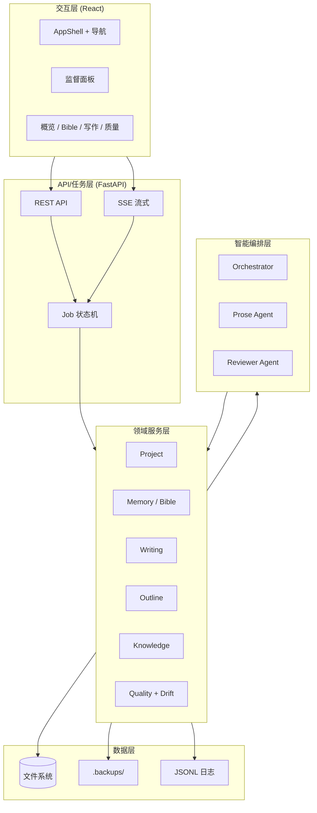
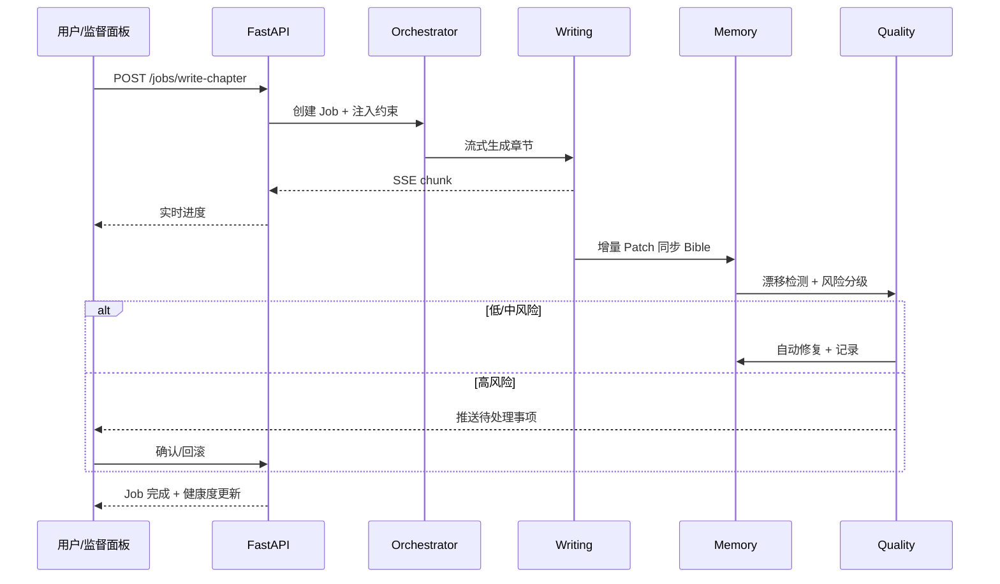

# xsagent v2.0 — 开发文档与实施计划

> **文档版本**：v1.1  
> **更新日期**：2026-06-17  
> **依据**：[需求文档.md](./需求文档.md) · [UI设计规范.md](./UI设计规范.md)  
> **目标读者**：研发、测试、产品

---

## 1. 文档目的

本文档将需求文档中的功能边界、自动化闭环与监督式 UX，落地为可执行的**技术架构、模块划分、接口契约与分阶段实施计划**。开发过程中以本文档为工程基线，UI 实现严格遵循 **Warm Industrial** 设计规范。

**MVP 收敛原则**（来自需求 v2.0）：

- 默认 **AI 自动闭环**，用户以监督为主
- 初期编排层仅保留 **Orchestrator + Prose + Reviewer** 两个子代理
- 监督面板覆盖 90% 以上干预场景
- 本地优先（Ollama），数据落盘于项目目录
- **纯 Web 入口**：不提供 CLI；项目创建、配置、写作、监督均在浏览器完成

**与需求文档差异**：需求 FR-01 中的 `xsagent init` / `status` 命令行能力**不在本期实现**；等价能力由 Web 首页 + `POST/GET /api/projects` 承担。

---

## 2. 技术选型

| 层级 | 技术 | 说明 |
|------|------|------|
| 前端 | React 18 + Vite + TypeScript | 监督面板、Bible 可视化、写作流 |
| 样式 | CSS Variables + Tailwind（可选） | 对齐 UI Token；噪声纹理、栅格用原生 CSS |
| 状态 | Zustand + TanStack Query | 全局 UI 状态 + 服务端缓存/SSE |
| 路由 | React Router v6 | 多页面工作台 |
| 图标 | Lucide React | 线宽 1.5px |
| 后端 | Python 3.11+ FastAPI | REST + SSE |
| 任务 | asyncio + 内存/文件 Job 队列 | MVP 不用 Redis；后续可换 Celery |
| LLM | Ollama（默认）+ 可插拔 Provider | 结构化 JSON 输出 |
| 存储 | 文件系统（JSON/MD/JSONL） | 章节 MD 为事实源；`.backups/` 快照 |
| 部署 | uvicorn 直接启动 FastAPI | `python -m xsagent` 或 `uvicorn`；无独立 CLI 包 |
| 测试 | pytest + httpx + Playwright | API + E2E 自动流 |
| 组件预览 | Storybook 或 Vite 静态预览页 | P4.1 冻结基础组件 |

---

## 3. 系统架构

### 3.1 逻辑分层



### 3.2 核心事件流（写作闭环）



### 3.3 仓库目录结构（建议）

```
newxsagent/
├── packages/
│   └── web/                    # React 前端
│       ├── src/
│       │   ├── app/            # 路由、布局
│       │   ├── components/     # 基础 + 业务组件
│       │   ├── features/       # 按领域拆分
│       │   ├── hooks/
│       │   ├── styles/         # tokens.css, noise, grid
│       │   └── api/
│       └── .storybook/         # 可选
├── src/xsagent/                # Python 后端包
│   ├── api/                    # FastAPI routers
│   ├── core/                   # 配置、异常、依赖注入
│   ├── domain/                 # 领域模型 + 服务
│   │   ├── project/
│   │   ├── memory/
│   │   ├── writing/
│   │   ├── outline/
│   │   ├── knowledge/
│   │   └── quality/
│   ├── agents/                 # Orchestrator, Prose, Reviewer
│   ├── jobs/                   # Job 状态机、事件
│   ├── llm/                    # Provider 抽象、结构化输出
│   └── storage/                # 文件读写、快照、Patch
├── tests/
│   ├── unit/
│   ├── api/
│   └── e2e/
├── templates/                  # 项目初始化模板
├── pyproject.toml
├── package.json                # monorepo 根（pnpm workspace）
└── README.md
```

### 3.4 项目数据目录（Web 创建项目时由 API 初始化）

项目存储于服务端数据根目录（`XSAGENT_DATA_DIR`），每个项目独占子目录：

```
data/projects/{project_id}/
├── xsagent.json                # 项目元信息 + 干预级别
├── config.yaml                 # LLM、阈值、模板
├── story_bible/
│   ├── characters.json
│   ├── plot.json
│   ├── world.json
│   ├── notes.json
│   └── timeline.json
├── outlines/
│   ├── master.json
│   ├── volumes/
│   └── chapters/
├── chapters/
│   └── ch_001.md
├── knowledge/
│   └── graph.json
├── logs/
│   └── actions.jsonl
└── .backups/
    └── {timestamp}/
```

---

## 4. 领域模型

### 4.1 核心实体

| 实体 | 关键字段 | 说明 |
|------|----------|------|
| `Project` | `id`, `name`, `genre`, `intervention_level` | 干预级别：`aggressive` / `balanced` / `conservative` |
| `ProjectConfig` | `words_per_chapter`, `auto_fix_threshold`, `ollama_model` | 运行参数 |
| `StoryBible` | `characters`, `plot`, `world`, `notes`, `timeline` | 支持 `locked_fields` |
| `BiblePatch` | `updates[]`, `risk_level`, `explanation`, `source_chapter` | JSON Patch 语义 |
| `MasterOutline` | `acts`, `themes`, `completion` | 总纲 |
| `VolumeOutline` | `volume_id`, `arcs`, `chapter_range` | 分卷 |
| `ChapterBlueprint` | `chapter_id`, `beats`, `constraints` | 章级蓝图 |
| `Chapter` | `id`, `title`, `content_md`, `word_count` | **正文为最终事实源** |
| `Finding` | `type`, `severity`, `description`, `suggested_patch` | 漂移/质量问题 |
| `Job` | `id`, `type`, `status`, `events[]`, `result` | 异步任务 |
| `ActionLog` | `timestamp`, `action_type`, `diff_summary`, `rollback_ref` | 监督面板数据源 |
| `HealthScore` | `overall`, `session`, `pending_count` | 0–100 |

### 4.2 风险分级与干预策略

| 级别 | 颜色（UI） | 系统行为 | 用户行为 |
|------|------------|----------|----------|
| `low` | 灰色 | 静默自动完成 | 可查看日志 |
| `medium` | 黄色 | 默认已处理，记录 Diff | 可回滚 |
| `high` | 红色 | 暂停相关自动动作 | **必须确认** 或回滚 |

干预级别映射：

- `aggressive`：medium 及以下全自动；high 推送但可配置超时自动采纳
- `balanced`（默认）：low/medium 自动；high 需确认
- `conservative`：low 自动；medium/high 均需确认

### 4.3 Patch 与快照

- 所有 Bible 变更通过 `BiblePatch` 应用，附带 `metadata`（来源章节、Job ID、风险级别）
- 每次自动修复前写入 `.backups/{timestamp}/`
- 回滚 = 恢复快照 + 反向 Patch 记录到 `actions.jsonl`

---

## 5. API 设计

### 5.1 REST 端点（MVP）

| 方法 | 路径 | 对应 FR | 说明 |
|------|------|---------|------|
| `POST` | `/api/projects` | FR-01 | Web 创建项目（替代 CLI init） |
| `GET` | `/api/projects/{id}` | FR-01 | 项目详情 + 健康度 |
| `GET` | `/api/projects/{id}/status` | FR-01 | 健康度概览（概览页同源） |
| `GET` | `/api/projects` | FR-01 | 项目列表 |
| `PATCH` | `/api/projects/{id}` | FR-01 | 更新配置（干预级别等） |
| `POST` | `/api/projects/{id}/onboarding` | FR-02 | AI 生成初始 Bible |
| `POST` | `/api/projects/{id}/onboarding/apply` | FR-02 | 批量采纳 Diff |
| `GET/PUT` | `/api/projects/{id}/bible/{section}` | FR-04 | Bible CRUD |
| `POST` | `/api/projects/{id}/bible/patch` | FR-04 | 预览/应用 Patch |
| `GET` | `/api/projects/{id}/outlines/**` | FR-05 | 三级大纲 |
| `POST` | `/api/projects/{id}/outlines/regenerate` | FR-05 | 动态微调 |
| `GET` | `/api/projects/{id}/chapters` | FR-03 | 章节列表 |
| `GET` | `/api/projects/{id}/chapters/{cid}` | FR-03 | 章节正文 |
| `POST` | `/api/projects/{id}/jobs/write-chapter` | FR-03 | 默认异步提交写作 Job（返回 `job_id`） |
| `POST` | `/api/projects/{id}/jobs/write-chapter-sync` | FR-03 | 同步执行写作闭环（调试/回归） |
| `POST` | `/api/projects/{id}/jobs/write-chapter-submit` | FR-03 | 显式异步提交（兼容端点） |
| `GET` | `/api/projects/{id}/jobs/{jid}` | — | Job 状态 |
| `GET` | `/api/projects/{id}/jobs/{jid}/events` | — | SSE 事件流 |
| `GET` | `/api/projects/{id}/pending` | FR-08 | 待处理高风险事项 |
| `GET` | `/api/projects/{id}/supervision` | FR-08 | 监督面板聚合数据 |
| `POST` | `/api/projects/{id}/supervision/resolve` | FR-08 | 采纳/忽略/回滚（含审计 actor） |
| `GET` | `/api/projects/{id}/knowledge/graph` | FR-07 | 轻量图谱 |
| `GET` | `/api/projects/{id}/quality/report` | FR-09 | 评估报告 |
| `POST` | `/api/projects/{id}/explore` | FR-10 | 多方案探索 |
| `POST` | `/api/projects/{id}/explore/{eid}/adopt` | FR-10 | 采纳方案 |

### 5.2 SSE 事件类型

```typescript
type SSEEvent =
  | { type: 'job.progress'; percent: number; stage: string }
  | { type: 'job.chunk'; content: string }           // 写作流式
  | { type: 'job.action'; log: ActionLog }         // 同步/修复/规划
  | { type: 'job.finding'; finding: Finding }      // 漂移发现
  | { type: 'job.complete'; result: JobResult }
  | { type: 'job.error'; message: string }
```

SSE 兼容 `Last-Event-ID` 续传，事件包含 `id:` 字段。

### 5.3 监督面板聚合接口

`GET /supervision` 返回：

```json
{
  "health": { "overall": 87, "session": 92, "pending_count": 2 },
  "recent_actions": [...],
  "pending_items": [...],
  "quick_links": { "bible": "...", "timeline": "...", "graph": "..." }
}
```

---

## 6. 智能编排层设计

### 6.1 代理职责

| 代理 | 职责 | 输入 | 输出 |
|------|------|------|------|
| **Orchestrator** | 任务分解、约束注入、风险路由 | 用户指令 + Project 上下文 | Job 步骤序列 |
| **Prose** | 章节正文生成 | Blueprint + Bible 摘要 + 风格 | Markdown 章节 |
| **Reviewer** | 同步、漂移检测、修复建议 | 章节正文 + Bible | Patch + Findings |

MVP **不引入**独立 Outline Agent、Knowledge Agent；其逻辑由 Orchestrator 调用领域服务 + 单次 LLM 完成。

### 6.2 上下文注入策略（Token 预算）

| 层级 | 内容 | 预算占比 |
|------|------|----------|
| L0 固定 | 风格 Notes、干预级别、字数 | 5% |
| L1 规划 | Master/Volume/Chapter Blueprint 摘要 | 15% |
| L2 记忆 | Bible 增量摘要（非全量） | 25% |
| L3 近期 | 最近 3 章摘要 + 当前章开头 | 35% |
| L4 预留 | 生成空间 | 20% |

每 10 章触发 **Compaction**：合并旧章摘要写入 `notes.json`，压缩 L3。

### 6.3 结构化输出

所有 LLM 调用使用 JSON Schema 约束（Patch、Findings、Blueprint 调整），配合：

- Few-shot 示例（需求文档 §14）
- 失败重试 2 次 + 降级到保守模式
- **LLM Simulator**（测试用固定响应）

---

## 7. 前端架构与页面规划

### 7.1 布局（AppShell）

```
┌──────────┬────────────────────────────────────┬──────────────┐
│ 左导航   │           主内容区                  │ 监督面板     │
│ 240px    │           flex-1                    │ 320px 可折叠 │
│          │                                       │              │
└──────────┴────────────────────────────────────┴──────────────┘
     ↑ 12 列栅格背景 + 噪声纹理（全局）
```

- 内容区 `max-width: 1440px`，`padding: 0 24px`
- `< 1024px`：左导航抽屉化；监督面板底部 Sheet
- `< 768px`：桌面提示条

### 7.2 路由与页面对照

| 路由 | 页面 | 需求 | UI 组件 |
|------|------|------|---------|
| `/` | 首页 / 项目列表 | FR-01 | Hero（Playfair）、**新建项目**表单、项目卡片 |
| `/projects/:id` | 概览 | FR-01 | 健康度卡片、进度、快捷写作 |
| `/projects/:id/onboarding` | 创作引导 | FR-02 | 分步表单、AI 预填、Diff 预览 |
| `/projects/:id/bible/characters` | 人物 | FR-04 | CharacterCard |
| `/projects/:id/bible/plot` | 情节 | FR-04 | 时间轴 |
| `/projects/:id/bible/foreshadowing` | 伏笔 | FR-04 | ForeshadowingBoard |
| `/projects/:id/bible/world` | 世界观 | FR-04 | 字段锁指示 |
| `/projects/:id/chapters` | 章节列表 | FR-03 | 表格 + 状态徽章 |
| `/projects/:id/chapters/:cid` | 章节阅读 | FR-03 | MarkdownView（65ch） |
| `/projects/:id/write` | 写作 | FR-03 | 指令输入、JobProgressPanel |
| `/projects/:id/outlines` | 规划 | FR-05/06 | 三级大纲树 + 完成度 |
| `/projects/:id/knowledge` | 知识图谱 | FR-07 | 轻量节点图 |
| `/projects/:id/quality` | 质量 | FR-09 | QualityDashboard |

### 7.3 监督面板（全局组件）

固定在右侧，所有页面共享，数据来自 `/supervision` + SSE `job.action`：

1. **HealthGauge** — 整体分 + 本次写作分 + 待办徽章
2. **ActionLogList** — 可展开，含回滚
3. **PendingItemsList** — 按风险排序，批量操作栏
4. **QuickLinks** — Bible / 时间线 / 图谱 / 导出

交互规则：

- Toast：低/中风险自动处理
- Modal（ApprovalModal）：仅高风险
- 免打扰模式：面板折叠，仅显示徽章数

### 7.4 设计 Token 落地（P4.1 优先）

创建 `packages/web/src/styles/tokens.css`：

```css
:root {
  --color-bg: #EBEBE8;
  --color-bg-elevated: #F5F5F2;
  --color-fg: #18181B;
  --color-fg-muted: #71717A;
  --color-accent: #0066FF;
  --color-accent-muted: #0066FF14;
  --color-border: #D4D4D8;
  --color-success: #16A34A;
  --color-warning: #CA8A04;
  --color-error: #DC2626;
  --ease-out-expo: cubic-bezier(0.16, 1, 0.3, 1);
  /* spacing, typography tokens ... */
}
```

**P4.1 基础组件清单**：`Button`、`Card`、`Label`、`Input`、`Textarea`、`Badge`、`AppShell`、`SideNav`、`NoiseOverlay`、`GridBackground`。

---

## 8. 分阶段实施计划

### 总览

| 阶段 | 名称 | 周期（估） | 交付物 | 需求覆盖 |
|------|------|------------|--------|----------|
| **P0** | 工程基座 | 1 周 | Monorepo、存储层、项目初始化 API、服务启动 | FR-01 |
| **P1** | 领域核心 | 1.5 周 | Bible/Chapter/Outline 模型与服务、快照 | FR-04, FR-09 基础 |
| **P2** | 智能编排 | 2 周 | Orchestrator、Prose/Reviewer、Patch 机制 | FR-03, FR-04, FR-08 |
| **P3** | API + Job | 1 周 | REST、SSE、监督聚合 API | 全部后端 FR |
| **P4** | Web UI | 2.5 周 | Warm Industrial 全站 + 监督面板 | FR-02, UI 规范 |
| **P5** | 规划与质量 | 1.5 周 | 三级大纲、漂移闭环、评估 | FR-05–09 |
| **P6** | 探索与打磨 | 1 周 | 探索采纳、E2E、10 章压测 | FR-10, 验收 |

**合计约 9–10 周**（无 CLI 可略缩短 P0；1 全栈 + 0.5 前端可压缩至 7 周）。

---

### P0 — 工程基座（第 1 周）

**目标**：启动 FastAPI 服务，通过 API 创建项目并落盘标准目录结构。

| 任务 | 详情 | 完成标准 |
|------|------|----------|
| P0.1 Monorepo 初始化 | pnpm workspace + pyproject.toml | 根目录一键 install |
| P0.2 存储抽象 | `ProjectStore`, 读写 JSON/MD | 单元测试通过 |
| P0.3 项目初始化服务 | `ProjectService.create()` 复制模板目录 | 与 §3.4 结构一致 |
| P0.4 项目 API | `POST/GET /api/projects`, `GET .../status` | 创建后可查健康度占位 |
| P0.5 FastAPI 骨架 | CORS、健康检查、OpenAPI、静态托管预留 | `/health` 200 |
| P0.6 配置系统 | 全局 `config.yaml` + 环境变量 | Ollama 地址可配置 |

**里程碑 M0**：`POST /api/projects` 创建项目后，`GET /api/projects/{id}/status` 返回健康度占位数据。

---

### P1 — 领域核心（第 2–3 周）

**目标**：Bible/Chapter/Outline CRUD 完备，快照可回滚。

| 任务 | 详情 | 完成标准 |
|------|------|----------|
| P1.1 领域模型 | Pydantic 模型 + 校验 | 模型单测 |
| P1.2 Bible 服务 | CRUD、字段锁、section 拆分 | API 可读写 |
| P1.3 Chapter 服务 | MD 读写、字数统计 | 章节为事实源 |
| P1.4 Outline 服务 | 三级结构、完成度计算 | JSON 持久化 |
| P1.5 快照服务 | 自动备份、回滚 | 回滚后数据一致 |
| P1.6 ActionLog | JSONL 追加写 | 日志可查询 |

**里程碑 M1**：通过 API 手动创建 Bible + 章节，快照回滚验证通过。

---

### P2 — 智能编排（第 4–5 周）

**目标**：端到端「写一章 → 同步 Bible → 检测漂移」后台闭环。

| 任务 | 详情 | 完成标准 |
|------|------|----------|
| P2.1 LLM Provider | Ollama 封装 + JSON Schema | Simulator 可切换 |
| P2.2 Prose Agent | 章节写作 Prompt + 流式 | 输出合法 MD |
| P2.3 Reviewer Agent | 同步 Patch + 漂移 Findings | 结构化 JSON |
| P2.4 Patch 引擎 | 应用/预览/冲突检测 | 字段锁不可写 |
| P2.5 Orchestrator | 步骤状态机、风险路由 | 低/中自动、高暂停 |
| P2.6 Compaction | 每 10 章摘要压缩 | Token 预算可控 |

**里程碑 M2**：API 触发写 1 章，Bible 自动更新，日志可查，高风险进入 pending。

---

### P3 — API + Job 层（第 6 周，已完成）

**目标**：前端可调用的完整 API + SSE。  
**当前状态**：已实现并通过回归测试（`36 passed`）。

| 任务 | 详情 | 完成标准 |
|------|------|----------|
| P3.1 Job 状态机 | `pending/running/completed/failed` | 已完成（内存态 JobManager，按项目隔离） |
| P3.2 写作 Job API | `write-chapter` + SSE | 已完成（默认异步 + 同步调试端点 + chunk 事件） |
| P3.3 监督 API | `/supervision` 聚合 | 已完成（健康度、日志、待办、快捷入口） |
| P3.4 解决 API | 采纳/回滚/忽略 | 已完成（`apply/ignore/rollback` + 审计元数据） |
| P3.5 Onboarding API | 生成 + apply diff | 已完成（草案生成与应用） |
| P3.6 OpenAPI 文档 | 自动生成 + 示例 | 已完成（关键请求体含 example） |

**里程碑 M3**：已达成（集成测试覆盖核心 API；SSE 事件序列与 `Last-Event-ID` 续传已断言）。

---

### P4 — Web UI（第 7–9 周）✅ 已完成

与 UI 设计规范阶段对齐。

| 子阶段 | 任务 | 完成标准 | 状态 |
|--------|------|----------|------|
| **P4.1** 设计系统 | Token CSS、AppShell、基础组件、组件预览页 | 组件预览冻结 | ✅ |
| **P4.2** Bible 视图 | CharacterCard、ForeshadowingBoard、MarkdownView | Bible 页可用 | ✅ |
| **P4.3** 写作流 | WritePage、JobProgressPanel、ChapterReader | 流式写作可视 | ✅ |
| **P4.4** 监督体验 | SupervisionPanel、ApprovalModal、Toast | 高风险 Modal | ✅ |
| **P4.5** 引导页 | Onboarding 分步 + Diff | FR-02 完整 | ✅ |
| **P4.6** 概览/导航 | 项目列表/创建、概览、侧栏、响应式 | 1280px 完整体验 | ✅ |

**里程碑 M4**：浏览器完成「引导 → 写一章 → 监督面板确认/回滚」全流程。

---

### P5 — 规划与质量（第 10 周）✅ 已完成

| 任务 | 详情 | 完成标准 | 状态 |
|------|------|----------|------|
| P5.1 大纲自动生成 | 写作后微调 Blueprint | 规划页显示 AI 推荐 | ✅ |
| P5.2 长篇规模推导 | 分卷/章节数动态调整 | 数据口径一致 | ✅ |
| P5.3 漂移闭环 UI | 待办列表 + 一键回滚 | FR-08 验收 | ✅ |
| P5.4 质量仪表盘 | QualityDashboard | 关键指标可见 | ✅ |
| P5.5 知识图谱（轻量） | 后台抽取 + 简单可视化 | 误报率人工抽检 | ✅ |

**里程碑 M5**：卷末评估报告自动生成；规划页完成度正确。

---

### P6 — 探索、测试与验收（第 11 周）🚧 进行中

| 任务 | 详情 | 完成标准 | 状态 |
|------|------|----------|------|
| P6.1 探索采纳 | 多方案生成 + 采纳到蓝图 | FR-10 | ✅ |
| P6.2 Golden Tests | 固定 LLM 响应回归 | CI 通过 | ✅ |
| P6.3 E2E | Playwright 自动流 | 引导→写作→监督 | ⏳ |
| P6.4 压测 | 连续写 10+ 章 | 无崩溃、快照正常 | ⏳ |
| P6.5 无障碍抽检 | 键盘导航、aria-live | 基线通过 | ⏳ |

**里程碑 M6（发布候选）**：满足需求 §11 全部验收标准。

---

## 9. 测试策略

### 9.1 测试金字塔

| 层级 | 范围 | 工具 |
|------|------|------|
| 单元 | Patch 引擎、完成度计算、风险路由 | pytest |
| 集成 | 领域服务 + 文件存储 | pytest + tmp_path |
| API | 端点 + SSE 序列 | httpx + pytest-asyncio |
| Golden | LLM 结构化输出解析 | 固定 fixture |
| E2E | 关键用户路径 | Playwright |
| 压力 | 1 万字连续生成 | 脚本 + 监控内存 |

### 9.2 关键 E2E 场景

1. 新建项目 → 引导采纳 → 自动写第 1 章
2. 继续写作 → 中风险自动修复 → 面板显示已处理
3. 注入高风险 Finding → Modal 确认 → Bible 更新
4. 回滚 AI 动作 → 快照恢复 → 日志记录
5. 免打扰模式 → 仅徽章提醒

### 9.3 验收清单（对齐需求 §11）

- [ ] 10 章以上项目全自动闭环无人工介入（balanced 模式）
- [ ] 监督面板覆盖 90%+ 干预场景
- [ ] 高风险决策用户确认率 < 20%（模拟测试统计）
- [ ] 概览页与 `GET /status` API 数据一致
- [ ] 压力测试通过（连续写作 + 漂移检测）

---

## 10. 风险与缓解

| 风险 | 影响 | 缓解措施 |
|------|------|----------|
| Ollama 结构化输出不稳定 | Patch 解析失败 | JSON Schema + 重试 + Reviewer 校验 |
| 长篇 Token 溢出 | 生成质量下降 | 分层注入 + Compaction |
| 自动修复误伤 | 剧情被改坏 | 字段锁 + 快照 + 回滚 |
| 监督面板信息过载 | 用户体验差 | 风险分级 + 免打扰 + 批量操作 |
| 前后端并行阻塞 | 延期 | P3 先用 OpenAPI mock；P4.1 组件先行 |
| 漂移误报率高 | 用户频繁确认 | 保守 Prompt + 图谱仅辅助 |

---

## 11. 开发规范

### 11.1 分支策略

- `main`：稳定可发布
- `develop`：集成分支
- `feature/p{N}-{name}`：阶段功能分支
- PR 需：测试通过 + 至少 1 人 Review

### 11.2 提交约定

```
feat(writing): add SSE chunk streaming
fix(bible): respect locked fields on patch apply
ui(panel): supervision health gauge
```

### 11.3 代码组织原则

- 领域逻辑不依赖 FastAPI/React
- LLM Prompt 集中 `agents/prompts/`
- UI 组件分 `primitives/`（P4.1）与 `features/`
- 所有自动动作必须写 `ActionLog`

---

## 12. 近期行动项（启动周）

| 序号 | 行动 | 负责人 | 产出 |
|------|------|--------|------|
| 1 | 确认 monorepo 工具链（pnpm + uv/poetry） | 研发 | 初始化 PR |
| 2 | 冻结 `xsagent.json` / `config.yaml` Schema | 研发 | JSON Schema 文件 |
| 3 | 搭建 P4.1 设计系统 + Storybook | 前端 | tokens.css + 5 组件 |
| 4 | 实现 P0 项目创建 API + 模板落盘 | 后端 | `POST /api/projects` 可用 |
| 5 | 定义 OpenAPI v0（P3 端点列表） | 后端 | openapi.yaml |
| 6 | 准备 LLM Simulator fixture | 测试 | `tests/fixtures/llm/` |

---

## 13. 附录

### A. 依赖版本（建议锁定）

```
python >= 3.11
fastapi >= 0.110
uvicorn >= 0.27
pydantic >= 2.6
httpx >= 0.27
react >= 18.2
vite >= 5.0
typescript >= 5.4
zustand >= 4.5
@tanstack/react-query >= 5.0
lucide-react >= 0.300
```

### B. 环境变量

| 变量 | 默认 | 说明 |
|------|------|------|
| `XSAGENT_DATA_DIR` | `./data/projects` | 项目文件存储根目录 |
| `OLLAMA_BASE_URL` | `http://localhost:11434` | LLM 服务 |
| `OLLAMA_MODEL` | `qwen2.5:14b` | 默认模型 |
| `XSAGENT_LOG_LEVEL` | `info` | 日志级别 |

### C. 文档索引

| 文档 | 用途 |
|------|------|
| [需求文档.md](./需求文档.md) | 功能边界与验收 |
| [UI设计规范.md](./UI设计规范.md) | 视觉与组件规范 |
| 本文档 | 技术落地与排期 |
| `openapi.yaml`（待建） | API 契约 |
| `ARCHITECTURE.md`（待建） | 实现后架构决策记录 |

---

*本文档随迭代更新；每完成一个阶段里程碑，回顾并修订 §8 计划与 §9 验收项。*
