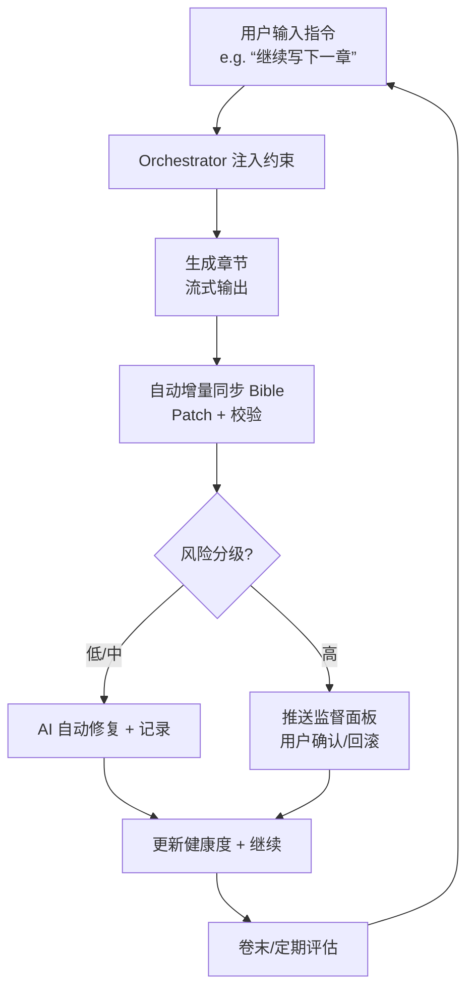

**# xsagent 系统功能架构与需求文档（优化版）**

> **文档版本**：v2.0（用户体验优化 + 自动化增强版）  
> **更新日期**：2026年6月  
> **适用范围**：当前已实现能力（P0–P6） + MVP 收敛范围 + 可持续演进基线  
> **目标读者**：产品、研发、测试、运营、内容团队  
> **核心变化**：大幅强化**监督式 UX**，默认 AI 自动闭环 + 问题驱动介入，减少用户点击动作 70%以上。

---

## 1. 文档目的
本文档作为 xsagent v2.0 的基线，定义优化后的系统边界、架构、功能与验收标准。重点解决 v1.0 中范围过大、一致性维护难、用户干预过多等问题。

核心回答：
- 系统现在做什么（MVP + 自动化闭环）
- 系统如何协同（简化架构 + 事件驱动）
- 系统后续应满足什么（监督优先 + 可扩展）

---

## 2. 产品定位与愿景
`xsagent` 是面向长篇小说创作的 AI 智能体系统，以 **Story Bible（结构化记忆）** 为中心，提供**监督式全自动辅助**。作者主要担任**监督者与最终决策者**，系统默认自主完成写作、同步、校验、轻微修正。

**核心价值**：从灵感快速落地到百万字稳定连载，极大降低烂尾、吃书、漂移成本，让作者专注创意而非工具操作。

---

## 3. 总体功能架构（优化后）
### 3.1 分层架构（简化版）
1. **交互层**：Web UI（React + Vite），统一“监督面板”
2. **API/任务层**：FastAPI + Job/SSE + 异步状态机
3. **领域服务层**：Project / Memory(Bible) / Writing / Outline / Knowledge / Quality / Drift（合并部分）
4. **智能编排层**：Orchestrator（主代理） + 可选子代理（初期仅 Prose + Reviewer）
5. **数据层**：Story Bible（JSON + MD） + Chapters（MD） + Outlines（JSON） + Knowledge Graph（轻量） + Logs/Baselines

### 3.2 核心闭环（自动化增强）
**自动写作 → 增量同步 → 轻量校验 → 低/中风险自动修复 → 高风险通知监督 → 继续**

**默认全自动**，仅高风险或用户配置时介入。

### 3.3 交互流程图（Mermaid 描述）



**主要流程**：
1. **新建项目到首章**：init → 加速引导（AI 预填） → 一键采纳 → 自动写作第1章
2. **长篇持续写作**：自动推进蓝图 → 后台校验 → 问题驱动介入
3. **修订闭环**：后台检测 → 自动/建议修复 → 监督面板统一处理

---

## 4. 核心业务对象（领域模型）
- **Project / Config**：元信息 + 干预级别（激进自动 / 平衡 / 保守）
- **Story Bible**：Character / Plot / WorldSetting / Notes / Timeline（支持字段锁 + Patch）
- **规划域**：MasterOutline / VolumeOutline / ChapterBlueprint（动态自动调整）
- **知识域**：轻量 Graph + Findings（衍生层）
- **任务域**：Job + Event（含自动动作日志）

---

## 5. 功能需求（FR，优化后）

### FR-01 项目初始化与配置
- 支持 `xsagent init` 快速创建项目
- 配置干预级别、自动修复阈值、题材模板等
- **验收**：`status` 显示健康度概览

### FR-02 创作引导（加速版）
- 一键生成初始 Bible（基于用户灵感）
- 分步可选，AI 预填 80% 内容，用户快速监督采纳
- **验收**：Web 自动续做 + 预览 Diff

### FR-03 章节写作与编排（核心自动化）
- 默认全自动：简单指令 → 后台生成 + 同步 + 轻修复
- 支持流式分段输出 + 中途反馈
- **验收**：写后 Bible 有追踪更新，监督面板显示健康度

### FR-04 Story Bible 可视化与自动维护
- CRUD + AI 自动补全（低风险静默）
- Diff 预览 + 批量采纳/回滚
- **验收**：Web 一致，字段锁有效

### FR-05 三级大纲规划
- 后台自动生成/动态微调
- 写作前自动注入最新蓝图
- **验收**：规划页展示 AI 推荐版 + 完成度

### FR-06 长篇规模规划
- 自动推导章节/分卷，动态调整
- **验收**：数据口径一致

### FR-07 知识图谱（轻量版）
- 后台抽取 + 校验
- 仅作为辅助，不主导写入
- **验收**：误报率可控

### FR-08 漂移检测与修复（分级自动）
- 后台定期检测
- 低/中风险：AI 自动修复
- 高风险：推送监督面板
- 支持一键回滚
- **验收**：完整闭环，日志可审计

### FR-09 评估与基线
- 后台自动运行，问题驱动报告
- **验收**：关键指标可见

### FR-10 探索采纳
- 后台多方案探索
- 一键采纳到写作计划

---

## 6. 监督面板 UI 描述（新核心特性）
**位置**：Web 端右侧固定侧边栏（可折叠）

**面板组成**：
- **顶部健康度仪表盘**：整体分数（0-100）、本次写作健康度、待处理事项计数（徽章）
- **最近 AI 动作日志**（可展开）：时间 + 动作类型（同步/修复/规划调整） + 简要 Diff + “回滚”按钮
- **待处理事项列表**（按风险排序）：
  - 高风险（红色）：必须确认
  - 中风险（黄色）：已默认处理，可回滚
  - 低风险（灰色）：已自动完成
- **批量操作**：全部采纳 / 全部回滚 / 忽略此类 / 配置阈值
- **快捷入口**：查看 Bible / 时间线 / 图谱 / 导出

**交互**：Toast 轻提示，仅高风险弹出模态窗。支持“免打扰模式”（仅汇总）。

---

## 7. 非功能需求（NFR，强化版）
- **一致性**：章节正文为最终事实，Bible 为结构化索引，自动 Patch 机制
- **稳定性**：重试 + 结构化输出 + 快照回滚
- **性能**：上下文分层注入 + Token 预算 + Compaction（每10章）
- **安全**：本地存储，默认 Ollama 支持
- **可测试性**：LLM 模拟器 + Golden Tests

---

## 8. 关键流程（端到端，自动化）
1. 新建项目 → AI 加速引导 → 监督采纳初始 Bible
2. 继续写作 → 自动闭环（生成+同步+修复）→ 监督面板轻查
3. 卷末 → 自动评估 + 规划调整 → 高风险介入
4. 漂移发生 → 分级处理 → 自动/确认 → 复检

---

## 9. 数据存储规范
- 章节正文优先
- Bible Patch 格式（JSON diff + metadata）
- 自动快照（.backups/）
- Git + 结构化 JSONL 日志

---

## 10. 角色与权限
- **作者**：监督者 + 最终决策
- **系统 AI**：默认执行者，严格遵守干预级别

---

## 11. 验收标准
- 完成全自动写作闭环（10章以上测试项目）
- 监督面板覆盖 90% 以上场景
- 高风险决策用户确认率 < 20%
- Web一致，稳定性通过压力测试

---

## 12. 迭代路线
**近期（高）**：
1. 监督面板 + 全自动写作闭环
2. 本地 Ollama + Patch 机制
3. 轻量漂移自动修复

**中期**：
1. 规划动态调整 + 模板
2. EPUB 导出
3. 个性化学习

**长期**：多作者、插件体系

---

## 13. 测试建议
- 单元 + API + E2E（自动流）
- 压力测试（模拟 1万字）
- 用户干预场景覆盖

---

## 14. 附录：核心提示词模板（示例）

### 14.1 章节写作 Prompt（注入约束）
```
你是一位专业网文作家，正在创作[题材]小说。
当前约束：
- 总纲：[MasterOutline 摘要]
- 本卷蓝图：[VolumeOutline]
- 本章蓝图：[ChapterBlueprint]
- 最新 Bible 关键事实：[Bible 增量摘要]
- 风格：[Style Notes]

要求：
- 严格遵守以上设定
- 字数约 [words_per_chapter]
- 节奏：[冲突→高潮→收束]
- 输出 Markdown 格式章节正文
```

### 14.2 Bible 同步 Prompt（增量 Patch）
```
从以下新章节正文中，提取增量事实：
- 新增/变更人物状态
- 时间线事件
- 伏笔进展
- 世界观细节

输出严格 JSON Patch 格式：
{
  "updates": [...],
  "risk_level": "low/medium/high",
  "explanation": "..."
}
仅输出可信事实，避免 hallucination。
```

### 14.3 漂移检测 Prompt
```
对比 Bible 与最新章节，找出不一致：
1. 时间线
2. 人物状态
3. 世界观规则
4. 伏笔

按风险分级输出 Findings 列表，并建议修复 Patch。
```

### 14.4 修复执行 Prompt
```
根据用户/系统偏好，生成修复方案：
- 自动应用低风险 Patch
- 提供 Diff 预览
保持故事连贯性和作者锁定字段。
```

**提示词工程原则**：全部使用结构化输出（JSON Schema）、Few-shot 示例、角色设定 + 负面约束。

---